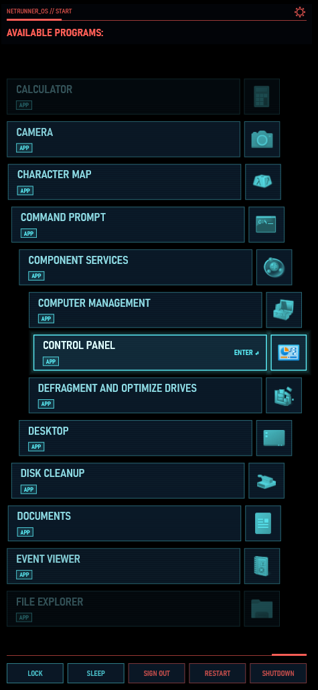
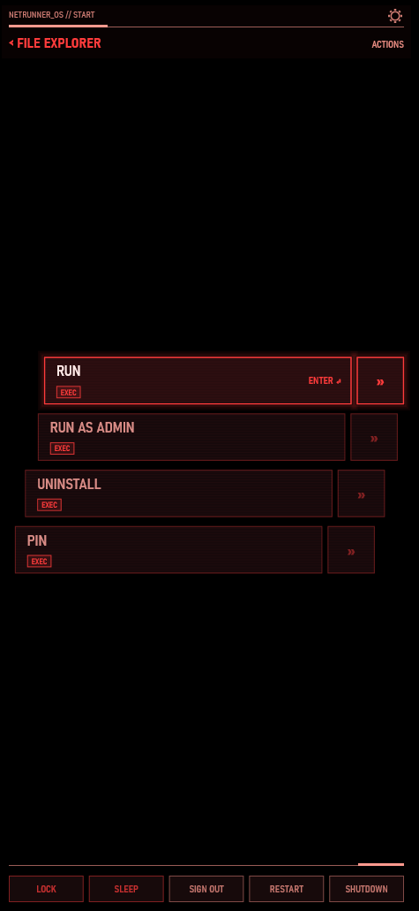
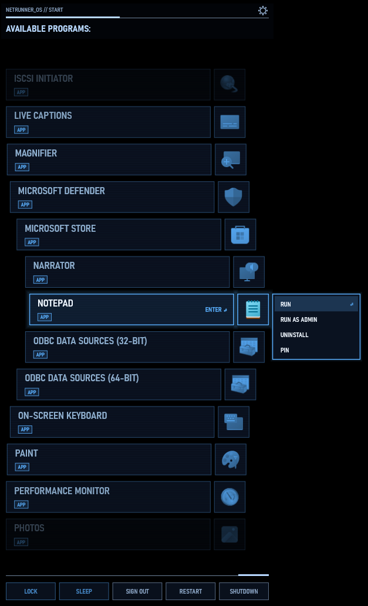
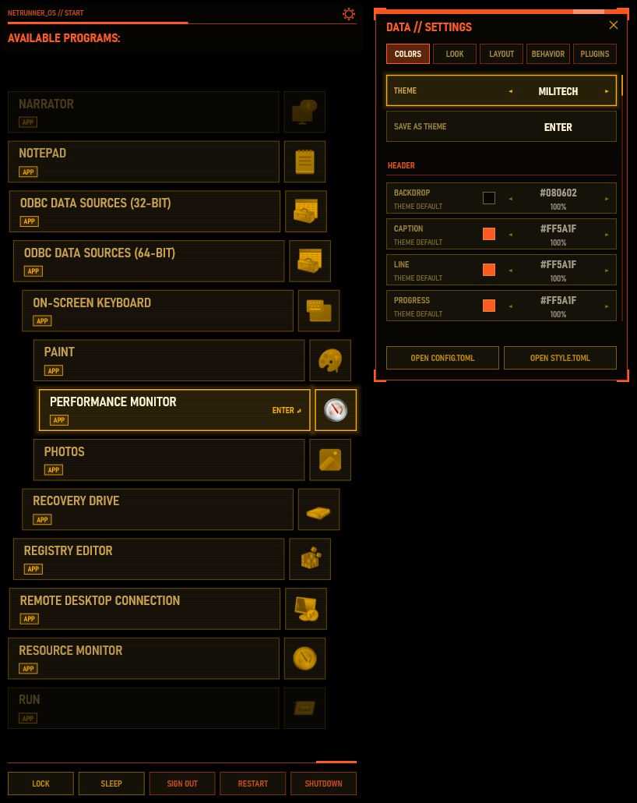

# cpmenu

A Start menu replacement for Windows in the style of the Cyberpunk 2077 quickhack menu: one small exe, a transparent Direct2D list that slides in over your desktop, apps, files, calculator, web search and plugins in a single box.

<p align="center">
  
  
  
  
</p>

## Features

- Looks like the quickhack picker: per-pixel transparent window, curved list, scanlines, glitch on open, tags (APP, PINNED, RECENT, FILE, DIR, CMD, CALC, WEB, OPEN, SET, EXEC ...).
- Tiny and quiet: a single exe of about 1.4 MB with no runtime dependencies (static CRT). The hidden menu uses about 1 MB of memory and 0% CPU (no timers, no frames when hidden). Open, it uses roughly 30-40 MB.
- Replaces the Start menu on the Win key (tap Win) or on any hotkey you choose.
- App search over the `shell:AppsFolder` index (Win32 and Store apps, plus desktop shortcuts), with prefix, word-start and initials matching ("vsc").
- Results ranked by how you actually use them; RECENT rows under the pinned ones while nothing is typed, with a CLEAR HISTORY row in BEHAVIOR.
- Windows settings in the results (Control Panel tasks) when you type a query.
- File search through [Everything](https://www.voidtools.com/) when it is running, with Windows Search as a fallback. No index of its own.
- Quick commands: `> command` (cmd), `? terms` (web search in your default browser), a calculator, and direct opening of URLs and paths.
- Actions for every result (right arrow or right click): run as admin, open file location, copy path, pin, open terminal here, uninstall, properties, and more. They can replace the list or open as a pop-out beside it.
- Power bar (lock, sleep, sign out, restart, shutdown) with a full-screen glitch confirmation for the destructive ones.
- Settings panel with five tabs: COLORS (themes and the color of every element, with opacity), LOOK (shape and corners, fonts per text role, GUI scale 50-250%, which header elements to draw, dimming), LAYOUT (side, width, rows, arc, backdrop, selection band, high contrast, icons, action placement), BEHAVIOR and PLUGINS.
- Themes (cyberpunk, arasaka, militech, netwatch and your own), rounded or chamfered corners, and optional first-run tutorial.
- Languages: English and Polish built in, any other language from a file. Every UI string can be overridden.
- Third-party plugins in any language, as separate processes talking JSON lines over stdin/stdout. A plugin cannot crash the menu.

## Requirements

- Windows 10 (version 1703 or newer) or Windows 11, 64-bit (x64).
- Nothing else to install: no Rust, no Visual C++ redistributable.
- Optional: [Everything](https://www.voidtools.com/) for file search.
- Optional: Python, Node.js or PowerShell 7, only for plugins that use them. The bundled examples need Python (`hello`) and Windows PowerShell (`hellops`).

## Install

1. Download the latest `cpmenu-<version>.zip` from the Releases page and unpack it anywhere.
2. Run `cpmenu-setup.exe` (double-click).

   It copies `cpmenu.exe` to `%LOCALAPPDATA%\cpmenu`, adds it to autostart (`HKCU\Software\Microsoft\Windows\CurrentVersion\Run`, value `cpmenu`) and starts it in the background; open the menu with a tap of Win.
3. To update, run the setup from the new version (the running copy is closed and replaced). Settings, themes, languages and plugins are kept.

Or skip the installer entirely: just run `cpmenu.exe` from wherever you like. Autostart can be switched on and off inside the menu: F2, BEHAVIOR, AUTOSTART.

Command line: `cpmenu.exe toggle | show | hide | quit` talk to the running instance. `cpmenu.exe install [exe]` installs the given exe (default: the one you ran), which is what the setup does. `cpmenu.exe plugin check <folder>` validates and test-runs a plugin.

## Uninstall

```powershell
& "$env:LOCALAPPDATA\cpmenu\cpmenu.exe" quit
Remove-Item -Recurse "$env:LOCALAPPDATA\cpmenu"
Remove-ItemProperty "HKCU:\Software\Microsoft\Windows\CurrentVersion\Run" -Name cpmenu
# optional: settings, themes, languages and plugins
Remove-Item -Recurse "$env:APPDATA\cpmenu"
```

## Usage

Open the menu with a tap of the Win key (the Start menu does not open) or your configured hotkey, and just start typing. The first run shows a short tutorial; BEHAVIOR, RUN TUTORIAL starts it again.

| Input | What it does |
|---|---|
| Win tap / hotkey | Show or hide the menu. Win+other key still goes to Windows. |
| Typing | Searches apps, settings and files. Typing closes the actions list. |
| Up / Down, PgUp / PgDn, Home / End, mouse wheel | Move through the list. |
| Enter, left click | Run the selected item (open it, copy the calculator result, ...). |
| Ctrl+Enter | Run a `>` command as administrator; on a plugin row, its alternative action. (Apps: → then RUN AS ADMIN.) |
| Right arrow, right click on a row | Open the actions of the selected item (as a new list or a pop-out, see LAYOUT). Left arrow, Esc or right click again goes back. |
| Ctrl+P | Pin or unpin the selected app (pinned apps come first). |
| Backspace, Ctrl+Backspace | Delete a character or a whole word. |
| Ctrl+V, Shift+Insert | Paste the first line of the clipboard into the query (also into text fields in the settings panel). Right click on the header has PASTE too. |
| Ctrl+C | On a plugin row, copy that row's text. |
| `> command` | Run a command in `cmd` (Ctrl+Enter for admin). |
| `? terms` | Web search in your default browser (or the `search_url` you set). |
| Math expression, e.g. `15,5/2` or `(2+3)^2` | Calculator. Operators `+ - * / % ^ ( )`, comma or dot. Enter copies the result to the clipboard. |
| URL, domain or path | Opens it directly. |
| Tab / Shift+Tab | Move focus to the power bar and back to the list. Left / Right choose a button, Enter presses it. |
| F2, Ctrl+, , gear icon, right click on the header | Open or close the settings panel. |
| Esc | Goes back one level at a time: close the confirmation, popup or settings; then the actions list; then clear the query; then hide the menu. |

The confirmation for sign out, restart and shutdown defaults to focus on ABORT. Enter confirms, Esc aborts, and an auto-repeated Enter is ignored.

## Configuration

Everything can be changed from the settings panel (F2) and takes effect at once. Files live in `%APPDATA%\cpmenu\`:

| Path | What |
|---|---|
| `config.toml` | Main settings. Edited by hand or by the panel; the panel keeps your comments and formatting. A broken file is never overwritten. |
| `style.toml` | The color of every element (`#RRGGBB` or `#RRGGBBAA`, where AA scales that element's opacity), plus `[shape]` (corner radius, chamfer, border, row height and gap, tag size), `[fonts]` (family per text role, size, weight) and `[show]` (what is drawn). A missing key means the theme's value. Created from the panel. |
| `themes\*.toml` | Your own themes. SAVE AS THEME in the COLORS tab writes the current colors there; copy and edit to make more. |
| `lang\*.toml` | Your own languages (same layout as [`lang/en.toml`](lang/en.toml)). Pick one with `language = "<file name>"`. |
| `plugins\` | Installed plugins, one folder each. |

The app index and usage history are cached in `%LOCALAPPDATA%\cpmenu\` (`apps.bin`, `usage.json`); delete them and they are rebuilt.

Main sections of `config.toml` (the full list of keys, with comments, is the template in [`src/config.rs`](src/config.rs); the panel's OPEN CONFIG.TOML button creates the file from it):

- Top level: `pinned = [...]` and `search_url` (`?` search engine, `{}` is replaced by the terms; unset = your default browser's own engine).
- `[colors]`: `theme` (`cyberpunk`, `arasaka`, `militech`, `netwatch`, or a file name from `themes\`) and hex overrides of the eight roles `accent alert tag quick text text_dim panel backdrop`.
- `[layout]`: `side`, `width_percent`, `visible_rows`, `arc_shift`, `backdrop_opacity`, `short_list`, `band_percent`, `gui_scale` (50-250 in steps of 10; the old `text_size` is still read), `high_contrast`, `icons`, `actions` (`list` or `popout`), `actions_anchor`, `actions_x`, `actions_y`.
- `[behavior]`: `hotkey` (`win`, `lwin`, `rwin`, `capslock`, `f1`..`f24`, a combination such as `ctrl+alt+space`, or `none`), `file_search`, `file_results`, `recent`, `confirm_power`, `language` (`auto`, `en`, `pl` or a file name), `plugins`, `onboarded`.
- `[text]`: replaces any UI string by its id, for example `"header.title" = "MY_OS // START"`. The ids are the keys of `lang/en.toml`.

## Plugins

A plugin is a folder in `%APPDATA%\cpmenu\plugins\` with a `plugin.json` manifest and a program in any language that answers JSON lines on stdin/stdout. It gets a keyword (`gh something`) or can opt in to every query. Each plugin must be approved by you before it runs the first time, runs in a job object and is shut down when idle. The PLUGINS tab in the settings panel lists them, opens the folder and the logs.

- Protocol, manifest and security model: [docs/plugins.md](docs/plugins.md).
- Working examples in Python and PowerShell: [plugins-examples/](plugins-examples/).
- Check a plugin from the command line: `cpmenu.exe plugin check <folder>` (from PowerShell, add `| Out-Host` to wait for the output).

## Windows Defender / SmartScreen false positive

cpmenu is a new, unsigned binary, and it does several things that antivirus heuristics look at:

- It installs a low-level keyboard hook (`WH_KEYBOARD_LL`) to see a tap of the Win key and keep Windows from opening Start. Keyloggers use the same API. cpmenu only looks at the hotkey and the characters you type into its own menu, stores nothing and sends nothing anywhere.
- It uses `SendInput` to swallow the Win release so Start stays closed.
- It reads and writes the clipboard (the calculator result, Copy path, paste).
- It adds itself to `HKCU\...\Run` for autostart (you can turn that off).
- It launches other programs and, for plugins, child processes.

A new unsigned exe with no download reputation also triggers SmartScreen ("Windows protected your PC"). This is a heuristic false positive, not a detection of known malware, but you do not have to take my word for it:

- Allow it: SmartScreen, More info, Run anyway. For Defender, Windows Security, Virus & threat protection, Protection history, restore the item and Allow on device, or add an exclusion for `%LOCALAPPDATA%\cpmenu`.
- Verify it: the whole source is in this repository, and you can build the exe yourself (next section) instead of downloading mine.
- If a release is flagged, you can submit it as a false positive at https://www.microsoft.com/wdsi/filesubmission.

## Building from source

Needs the Rust toolchain pinned in `rust-toolchain.toml` (rustup installs 1.99.0 with `x86_64-pc-windows-msvc` by itself) and the Visual Studio Build Tools (MSVC linker and Windows SDK). No other system libraries.

```powershell
cargo build --release     # target\release\cpmenu.exe and cpmenu-setup.exe
cargo test
```

`cpmenu-setup.exe` from that build is just the setup stub; a release zip pairs it with `cpmenu.exe` (the stub carries the exe as a trailer and extracts it on run). `cpmenu.exe install` (in `target\release`) also works straight from a checkout after `cargo build --release`.

## License

[MIT](LICENSE), Copyright (c) 2026 Cop3nd.

cpmenu is an unofficial fan project. It is not affiliated with, endorsed by or connected to CD PROJEKT RED. Cyberpunk 2077 is a trademark of CD PROJEKT S.A.
